# QuantumSafeTokens

Truly unpredictable OTP and API key generation using quantum superposition in Python (Qiskit).

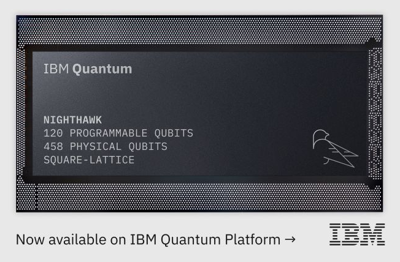

[IBM Quantum](https://quantum.cloud.ibm.com/) is a cloud based platform that gives developers and researchers public access to real, superconducting quantum hardware. Instead of classical bits that are strictly 0 or 1, IBM's quantum processing units (QPUs) utilize qubits, leveraging quantum mechanics like superposition and entanglement accessible directly via Python through the open source [Qiskit](https://www.qiskit.org) framework.

## Motivation

Standard programming tools like Python's `random` module rely on deterministic pseudo-random algorithms (such as the Mersenne Twister). Because their output can be mathematically reversed after observing just a few hundred outputs, the official [Python documentation explicitly warns](https://docs.python.org/3/library/random.html) against using them for security or cryptographic purposes.

While modern operating systems and Python's `secrets` module address this using Cryptographically Secure PRNGs ([CSPRNGs](https://en.wikipedia.org/wiki/Cryptographically_secure_pseudorandom_number_generator)), they still depend on OS entropy pools, which can be vulnerable to entropy starvation, virtualization bugs, or flawed seeds in containerized cloud environments.

## The Quantum Solution

**QuantumSafeTokens** leverages Quantum Random Number Generation (QRNG) via Qiskit, placing qubits into superposition using Hadamard gates. Because measuring these states triggers an intrinsically random physical collapse into 0 or 1, predictability is eliminated at the hardware level.

These raw measurements are converted directly into nondeterministic, unbiased API keys and 6-digit authentication codes delivering entropy guaranteed by quantum mechanics rather than software algorithms.

## IBM Quantum Setup

Create an account on the [IBM Quantum Platform](https://cloud.ibm.com/registration) and grab your API key to authenticate your environment.

|                                        |                                        |                                        |                                        |
| :------------------------------------: | :------------------------------------: | :------------------------------------: | :------------------------------------: |
| 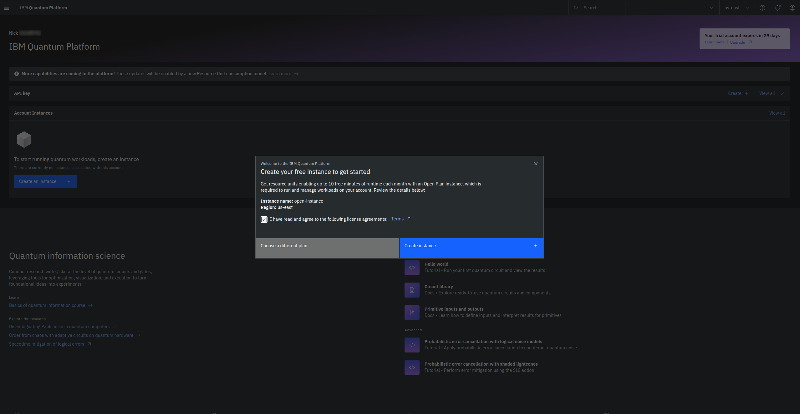 | 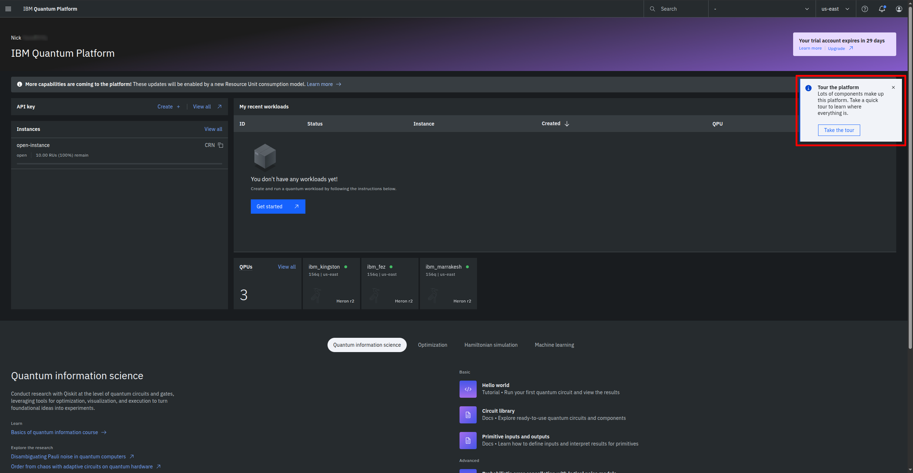 | 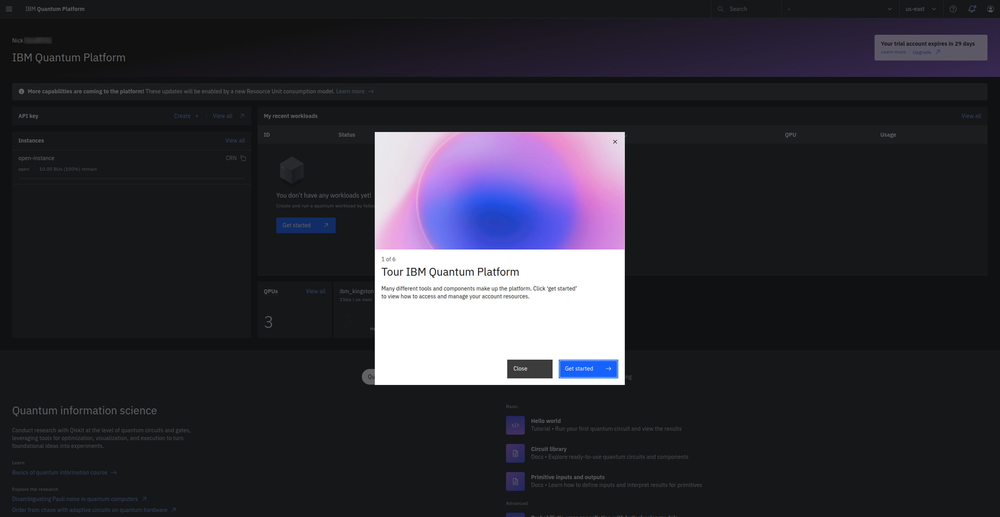 | 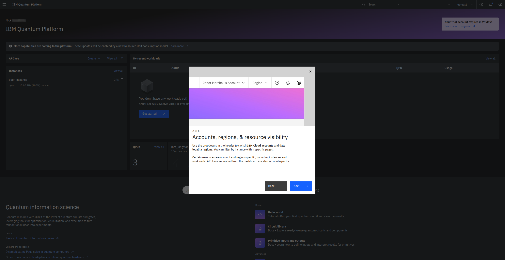 |
| 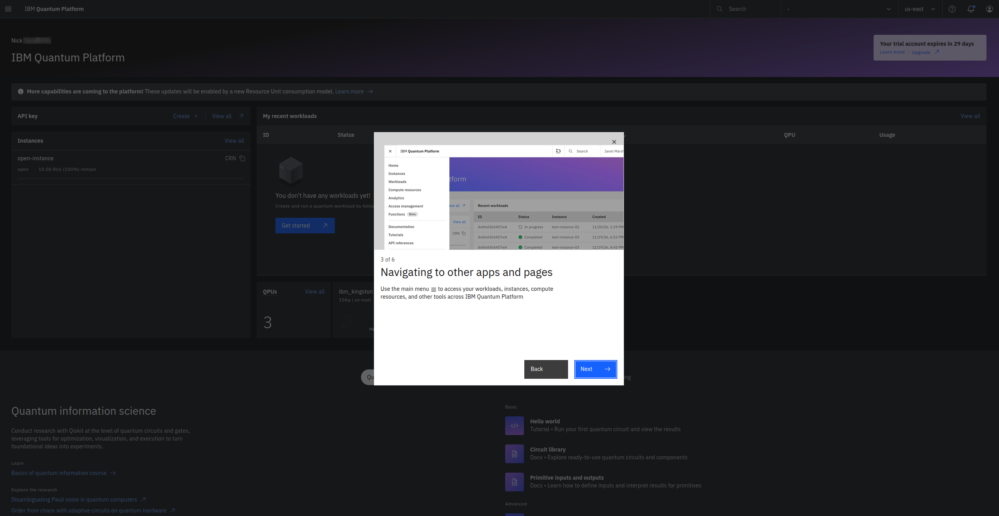 | 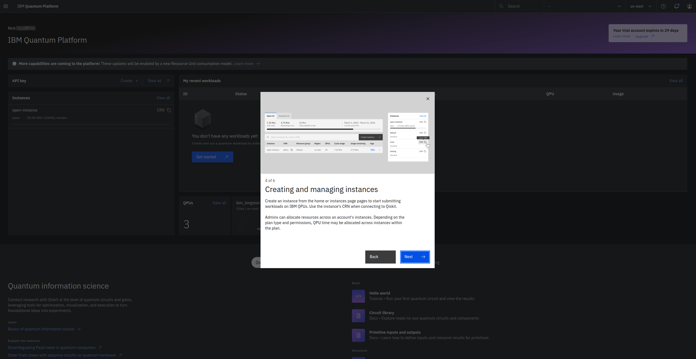 | 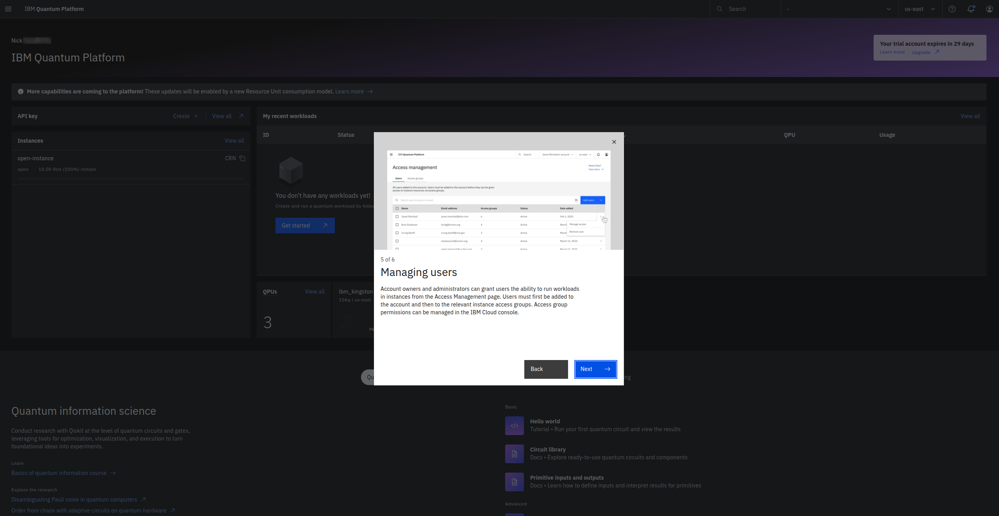 | 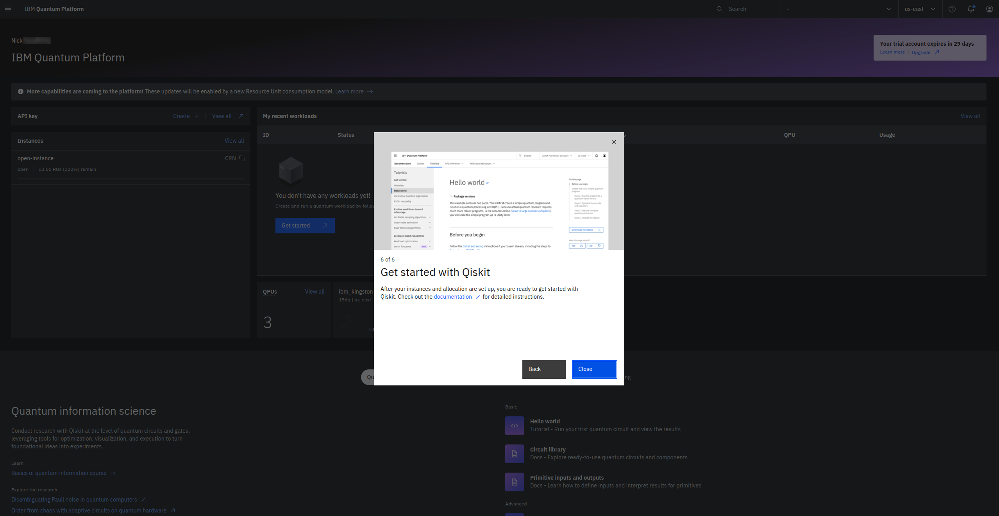 |
| 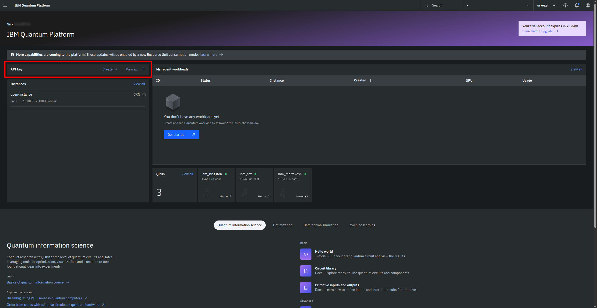 | 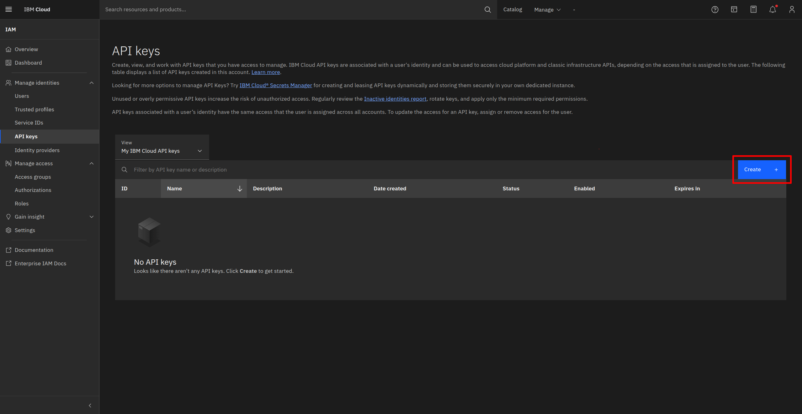 | 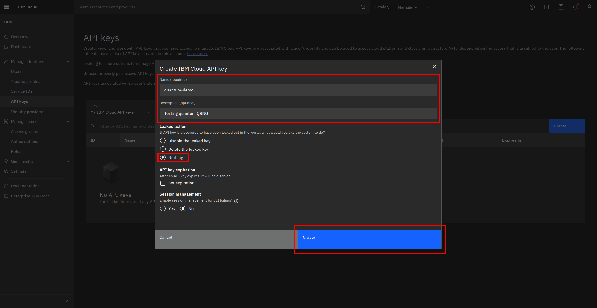 | 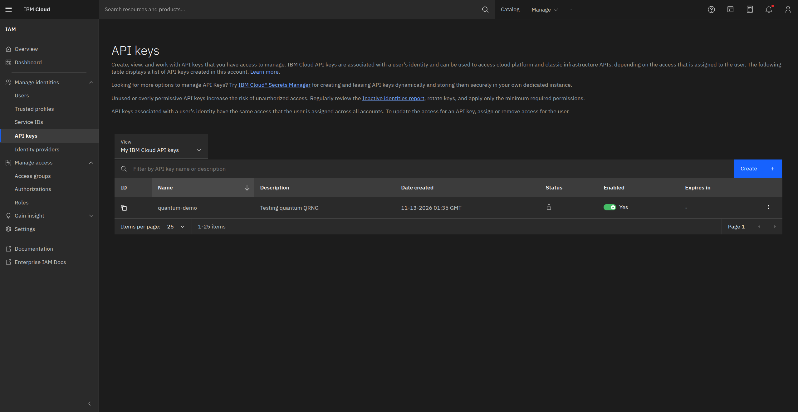 |

## Implementation

Build the quantum circuit with Qiskit, test it locally with Aer, and execute it on real quantum hardware.

```bash
python3 -m venv venv
source venv/bin/activate
pip install --upgrade pip
pip install qiskit qiskit-ibm-runtime python-dotenv
pip freeze > requirements.txt
cp .env.example .env

# Replace your_ibm_quantum_api_token_here with your key
vim .env
```

First, let's establish a connection to the IBM Quantum Platform to verify our API credentials and check the status of available quantum hardware.

```bash
python test_connection.py
```

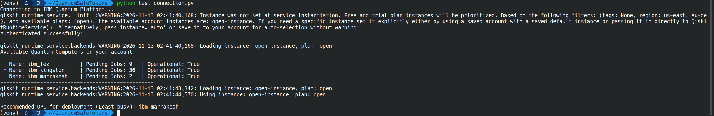

Next, let's install `qiskit-aer` Qiskit's high performance local simulator. This allows us to test and validate our circuits locally without waiting in cloud queues.

```bash
pip install qiskit-aer
python main.py
```

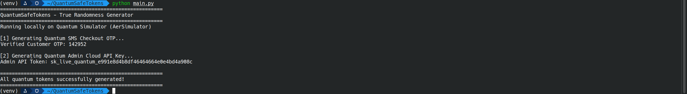

Ready for the real deal? Set `USE_HARDWARE = True` and run the script one last time to generate your tokens using genuine quantum superposition on real IBM Quantum hardware.

```bash
python main.py
```

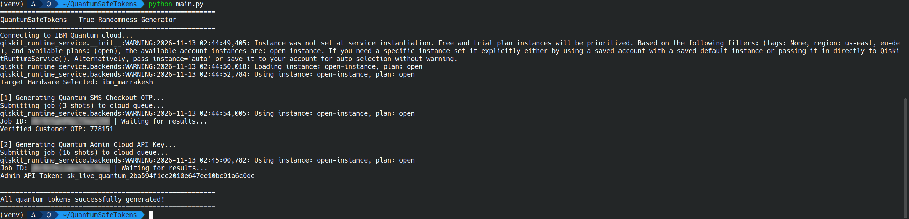

This is what the execution results look like inside the IBM Quantum dashboard after running the script. It confirms our entropy jobs completed successfully on physical hardware (`ibm_marrakesh`), displaying the live 156-qubit Heron architecture and calibration telemetry used to sample our tokens.

|                                        |                                        |
| :------------------------------------: | :------------------------------------: |
| 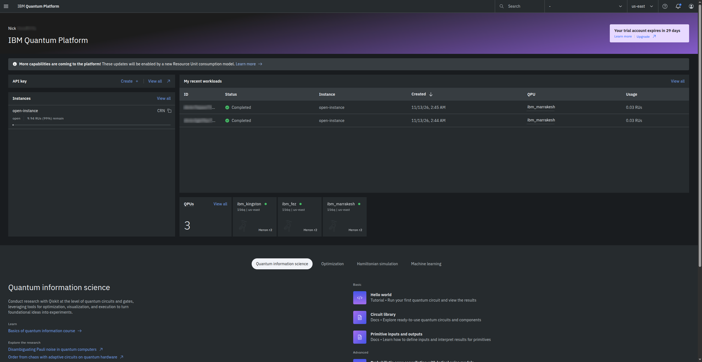 | 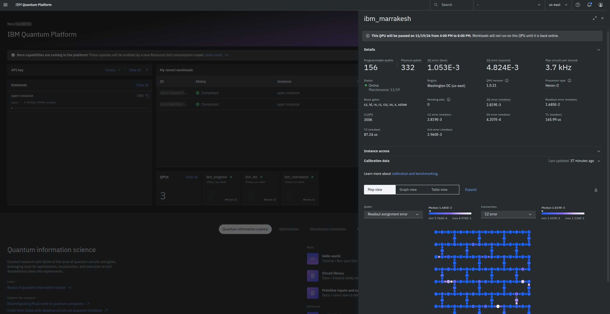 |

## License

MIT - See the [LICENSE](https://github.com/ncklinux/QuantumSafeTokens/blob/main/LICENSE) file in this project for details.

## Disclaimer

This project is currently under development, distributed FREE & WITHOUT ANY WARRANTY. Report any bugs or suggestions as an [issue](https://github.com/ncklinux/QuantumSafeTokens/issues/new).

## Commit Messages

This repository follows the [Conventional Commits](https://www.conventionalcommits.org) specification, the commit message should never exceed 100 characters and must be structured as follows:

```
<type>[optional scope]: <description>

[optional body]

[optional footer(s)]
```

## Note

I will keep and maintain this project as open source forever! [Watch it](https://github.com/ncklinux/QuantumSafeTokens/subscription), give it a :star: and follow me.

## Powered by


